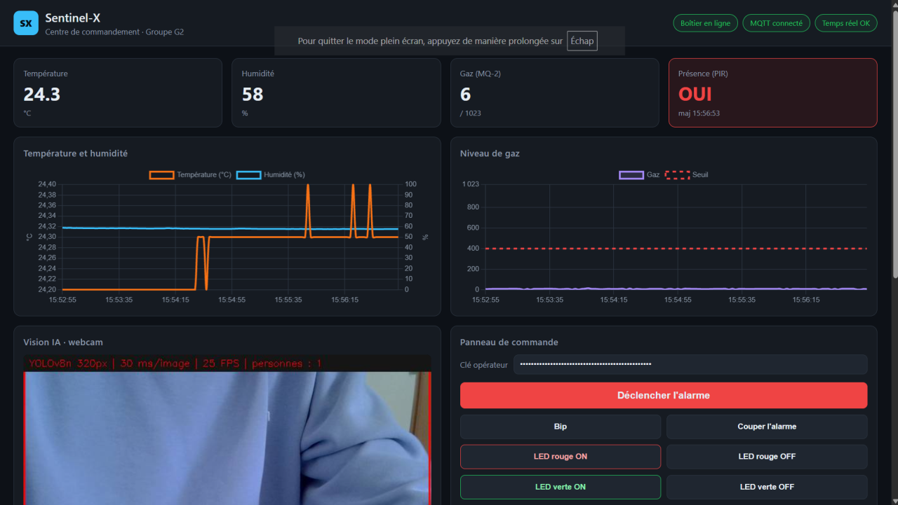
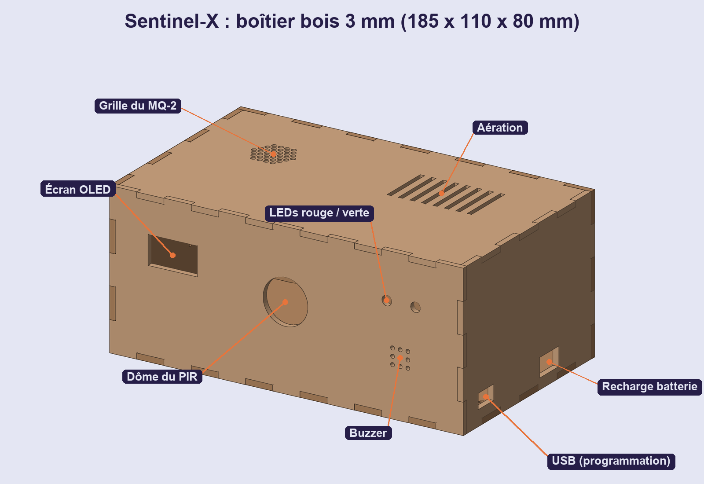
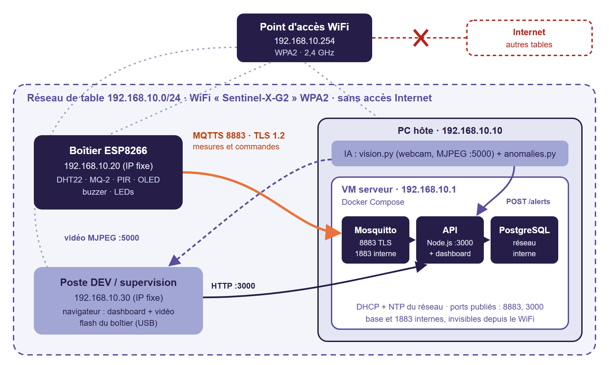
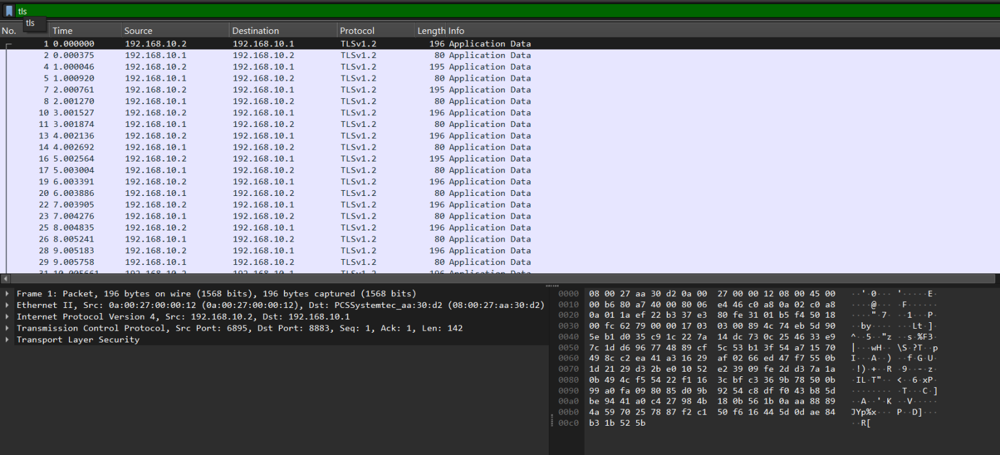

# Sentinel-X — L'avant-poste industriel du futur

Workshop EPSI 2026 (M1) — Groupe 2.
Boîtier de surveillance autonome : capteurs sur ESP8266 → MQTT chiffré (TLS) → serveur local conteneurisé
(Mosquitto, API Node.js, PostgreSQL) + IA de vision sur webcam et maintenance prédictive → dashboard de supervision
temps réel avec commande à distance des actionneurs.

**Option retenue : B — un PC portable sert de serveur local (machine virtuelle Linux + Docker Compose).**


## Aperçu

| Dashboard temps réel | Boîtier (découpe laser) |
|---|---|
|  |  |
| **Architecture et réseau de table** | **Flux chiffrés (Wireshark, port 8883)** |
|  |  |

En résumé :
- **moins d'1 seconde** entre la mesure du capteur et son affichage sur le dashboard ;
- flux **chiffrés de bout en bout** (MQTTS, TLS 1.2, autorité de certification privée) ;
- **30 attaques automatisées** contre l'API, aucune erreur ni redémarrage ;
- vision **YOLOv8n** à 30–50 ms par image sur CPU, maintenance prédictive par **Isolation Forest** ;
- boîtier en bois **découpé au laser**, batterie intégrée.

Schéma de câblage : [docs/images/cablage.png](docs/images/cablage.png).

## Équipe

| Membre | Filière | Périmètre |
|---|---|---|
| **Auréole EDJEKPOTO** | DEV | Firmware ESP8266, API REST/WebSocket, dashboard, panneau de commande, intégration |
| **Carl MEYER** | CLOUD & CYBER | Serveur virtualisé, Docker Compose, réseau de table, TLS, durcissement, audit |
| **Julien CARBONELL** | CLOUD & CYBER | Serveur virtualisé, Docker Compose, réseau de table, TLS, durcissement, audit |
| **Nicolas TOUAORO** | IA | Vision intelligente (YOLOv8), maintenance prédictive (Isolation Forest), optimisation des flux |

Le détail du travail de chacun est dans la section [Réalisations par filière](#réalisations-par-filière).

## Ce que fait le système

- Le boîtier mesure température, humidité, gaz et présence toutes les 2 s, les affiche sur son écran OLED
  et les publie en **MQTT chiffré (TLS 1.2)**.
- Le serveur enregistre tout dans **PostgreSQL**, détecte les changements d'état (gaz, mouvement, surchauffe,
  boîtier hors ligne) et les pousse en direct au dashboard (**Socket.io**).
- Une **IA de vision** repère les personnes sur la webcam (YOLOv8n) ; la vidéo annotée s'affiche dans le dashboard.
- Une **IA de maintenance prédictive** (Isolation Forest) signale un comportement anormal des capteurs
  avant que les seuils critiques ne soient atteints.
- Depuis le dashboard, l'opérateur déclenche à distance le **buzzer** et les **LEDs** du boîtier.

## Architecture

```
                      WiFi de table "Sentinel-X-G2" (WPA2, 192.168.10.0/24, sans Internet)
 ┌──────────────┐                         ┌──────────────── VM serveur 192.168.10.1 (Docker) ────────────────┐
 │ ESP8266 .20  │   MQTTS 8883 (TLS 1.2)  │  Mosquitto ──1883 interne──► API Node.js ──► PostgreSQL          │
 │ DHT22  MQ-2  │ ──────────────────────► │  (8883 publié)              (3000 publié)    (réseau interne)    │
 │ PIR    OLED  │ ◄────── commandes ───── │                                ▲   │                             │
 │ buzzer LEDs  │                         └────────────────────────────────┼───┼─────────────────────────────┘
 └──────────────┘                                   POST /api/v1/alerts    │   │ REST + Socket.io
                        ┌──────────────────────────┐                       │   ▼
                        │ Scripts IA (Python)      │───────────────────────┘  Dashboard web
                        │ vision.py  webcam USB    │── MJPEG :5000/video ───► http://192.168.10.1:3000
                        │ anomalies.py             │
                        └──────────────────────────┘
```

Le contrat d'échange entre les briques (topics, JSON, routes, ports, adresses) est dans
**[docs/CONTRAT.md](docs/CONTRAT.md)**, la mise en place du chiffrement dans **[docs/TLS.md](docs/TLS.md)**.

### Plan d'adressage

| Adresse | Machine |
|---|---|
| `192.168.10.1` | VM serveur : Mosquitto, API + dashboard, PostgreSQL ; DHCP et NTP du réseau |
| `192.168.10.10` | PC hôte de la VM : scripts IA + webcam USB, vidéo sur `:5000` |
| `192.168.10.20` | Boîtier ESP8266 (IP fixe) |
| `192.168.10.30` | Poste de développement et de supervision (secours IA) |
| `192.168.10.254` | Point d'accès WiFi de table |

---

## Réalisations par filière

### DEV — Auréole EDJEKPOTO

**Firmware ESP8266** (`firmware/`, C++ / PlatformIO, carte NodeMCU)
- Lecture cadencée non bloquante (`millis()`) : DHT22, MQ-2 (entrée analogique via pont diviseur), PIR ;
  publication JSON toutes les 2 s avec ArduinoJson.
- Écran OLED I2C : IP, état WiFi et MQTT, mesures, bandeau d'alerte ; détection réelle de l'écran par scan du bus I2C.
- MQTT avec **dernière volonté (LWT)** : le broker publie `offline` si le boîtier disparaît.
- **TLS (BearSSL)** : CA du groupe embarquée, heure NTP pour valider le certificat (date de compilation en secours),
  connexion authentifiée (compte `esp01`) ; message d'erreur TLS lisible en cas d'échec.
- Réseau : IP fixe, reconnexion automatique WiFi et MQTT sans jamais bloquer la boucle,
  diagnostic au démarrage (réseaux visibles, mot de passe refusé, réseau introuvable).
- Actionneurs : buzzer (continu ou bip), LED rouge (commande OU gaz détecté : un « off » ne masque jamais une fuite),
  LED verte témoin « tout va bien » pilotable depuis le dashboard.
- Aucun secret dans le code : WiFi, broker et certificat dans `include/secrets.h` (ignoré par Git, modèle `.example`).

**API** (`api/`, Node.js, Express, Socket.io, mqtt.js, pg)
- REST `/api/v1` avec le point d'entrée obligatoire **`POST /api/v1/alerts`**, et temps réel Socket.io.
- Abonnement MQTT à la télémétrie et à l'état du boîtier, publication des commandes (QoS 1), reconnexion automatique.
- Détection des changements d'état (front montant / retour à la normale) pour le gaz, le mouvement, la surchauffe,
  et chien de garde « boîtier hors ligne » après 10 s sans message.
- Stockage PostgreSQL (tables créées au démarrage, nouvelles tentatives tant que la base démarre),
  stockage mémoire automatique en développement.
- Configuration par variables d'environnement **ou secrets Docker** (`API_KEY_FILE`, `MQTT_PASSWORD_FILE`,
  `DATABASE_PASSWORD_FILE`).
- Sécurité applicative : voir [Sécurité](#sécurité).

**Dashboard** (`dashboard/`, JavaScript natif, Chart.js servi en local, aucune dépendance Internet)
- Tuiles température / humidité / gaz / présence, courbes temps réel (4 min glissantes) avec seuil de gaz.
- Statut du boîtier, de MQTT et du temps réel ; journal des alertes coloré par niveau et par source.
- Retour vidéo de la webcam analysée par l'IA, avec reconnexion automatique du flux.
- Panneau de commande protégé par la clé opérateur (gardée seulement le temps de l'onglet).
- Content-Security-Policy stricte : aucun script inline, affichage sans `innerHTML` (pas de XSS).

**Outils et tests** (`tools/`)
- `simulateur.js` : faux boîtier (mesures réalistes, fuite de gaz et passages périodiques) — plan B de la démo.
- `broker-dev.js` : broker MQTT de développement sans Docker.
- `pentest-api.js` : batterie de 30 attaques automatisées contre l'API (voir [Tests](#tests-réalisés)).

### CLOUD & CYBERSÉCURITÉ — Carl MEYER et Julien CARBONELL

**Virtualisation de l'infrastructure** (`infra/`)
- Serveur Linux en **machine virtuelle VirtualBox**, carte réseau en mode pont, IP fixe `192.168.10.1`.
- Stack **Docker Compose** : `mosquitto` (eclipse-mosquitto 2), `db` (PostgreSQL 16), `api` (image construite depuis le dépôt),
  redémarrage automatique et tests de santé sur les trois services.
- Volumes persistants pour la base et les messages retenus de Mosquitto.

**Routage et topologie de table**
- Point d'accès WiFi dédié `Sentinel-X-G2` (WPA2, 2,4 GHz) sans liaison vers Internet ni vers les autres tables.
- Plan d'adressage `192.168.10.0/24`, services DHCP et NTP portés par la VM, IP fixes pour le serveur et le boîtier.
- Réseau Docker `backend` interne (base de données et broker inaccessibles depuis le WiFi),
  ports publiés uniquement sur l'adresse du réseau de table.

**Sécurisation des flux**
- PKI du groupe : autorité `Sentinel-X CA` (RSA 4096) et certificat du broker avec l'IP en subjectAltName.
- Mosquitto : TLS 1.2 sur 8883, aucun accès anonyme, un compte par client (`esp01`, `api`), **ACL au moindre privilège**
  (le boîtier ne peut pas s'envoyer de commandes), limites de connexions, de taille de message et de file d'attente.

**Durcissement**
- Conteneurs non-root, `read_only`, `cap_drop: ALL`, `no-new-privileges`, limites mémoire, journaux bornés (3 × 10 Mo).
- Mots de passe et clé API en **secrets Docker** (fichiers), jamais en variables ni dans Git.
- Pare-feu : depuis le WiFi, seuls **3000** (API) et **8883** (MQTTS) répondent sur le serveur ; SSH, PostgreSQL et 1883 sont fermés.

**Monitoring et MCO**
- `infra/monitoring.sh` : charge, RAM, disque, CPU/mémoire de chaque conteneur, taille des données et journaux Mosquitto,
  historisés dans un CSV borné ; `docker stats` en temps réel.

**Audit et pentest** : scan de la table depuis le WiFi, contrôles TLS (anonyme, mauvais mot de passe, fausse CA),
capture Wireshark avant/après chiffrement, risques documentés dans [infra/README.md](infra/README.md).

### IA — Nicolas TOUAORO

Scripts Python autonomes (`ia/`, détails dans [ia/README.md](ia/README.md)).

**Vision intelligente** (`ia/vision.py`)
- Capture de la webcam USB dans un thread dédié (seule la dernière image est gardée : aucun retard accumulé).
- Détection de personnes avec **YOLOv8n** exporté en ONNX et exécuté par le module DNN d'OpenCV, sur CPU,
  suppression des doublons par NMS ; secours automatique sur le détecteur HOG d'OpenCV.
- Présence confirmée sur 3 des 5 dernières images, alerte `human_detected` (critique) à l'apparition,
  `state_change` au départ, au plus une alerte toutes les 10 s.
- Diffusion de la vidéo annotée en **MJPEG** sur le port 5000, affichée par le dashboard.

**Maintenance prédictive** (`ia/anomalies.py`)
- Aucune règle statique : un **Isolation Forest** (scikit-learn) apprend le fonctionnement normal du boîtier.
- Caractéristiques sur fenêtres glissantes de 30 s : niveaux, **pente de température**, **pente et variation du gaz**,
  pente d'humidité (régression linéaire).
- Réapprentissage toutes les 10 min uniquement sur les données jugées normales ; anomalie confirmée deux fois
  avant alerte `anomaly` expliquée (caractéristiques les plus éloignées de l'habitude, en écarts-types).
- Démonstration (`python anomalies.py --test`) : une hausse lente de température combinée à une micro-dérive du gaz
  est détectée à 23 °C et gaz 172, loin des seuils critiques (40 °C, 400).

**Optimisation des flux** : images bridées en 640×480, entrée du réseau à 320 px :
**35 à 50 ms par image** mesurés (sous l'objectif de 100 ms), temps de traitement incrusté sur la vidéo.

---

## Démarrage

### Serveur (VM, démo)

Préparation des secrets, certificats, comptes MQTT et droits : **[infra/README.md](infra/README.md)**.

```bash
cd infra
docker compose up -d --build
docker compose ps          # api, db, mosquitto : healthy
docker compose logs -f api # "[db] stockage : postgresql" puis "[mqtt] connecté"
```

Dashboard : **http://192.168.10.1:3000** (la clé opérateur est le contenu de `infra/secrets/api_key.txt`).

### Boîtier ESP8266

1. VS Code + extension **PlatformIO**, ouvrir `firmware/`.
2. Copier `include/secrets.example.h` en `include/secrets.h` et le remplir (WiFi, IP fixe, NTP, broker, compte MQTT, `ca.crt`).
3. Brancher la carte en USB : **Upload**, puis **Monitor** (115200 bauds).
4. L'écran affiche `IP 192.168.10.20` et `MQTT: OK`.

| Composant | Broche NodeMCU | Alimentation |
|---|---|---|
| Écran OLED SDA / SCL | D2 / D1 | 3V3 |
| DHT22 DATA | D5 | 3V3 |
| PIR HC-SR501 OUT | D6 | VIN (5 V) |
| MQ-2 AO | A0 via pont diviseur (deux résistances identiques : 5 V → 2,5 V max) | VIN (5 V) |
| Buzzer + | D7 | — |
| LED rouge / LED verte | D0 / D8 (résistance 220 Ω) | — |

Le MQ-2 chauffe 1 à 2 minutes avant de donner des valeurs stables ; le PIR se calibre pendant environ 1 minute.

**Calibrer le seuil de gaz** (après un remplacement du MQ-2) :
1. Laisser chauffer 2 minutes, relever la valeur au repos (tuile « Gaz » du dashboard ou `GET /api/v1/status`).
2. Approcher un briquet **sans flamme** 3 secondes à 3 cm du capteur et relever le pic.
3. Choisir un seuil entre les deux (avec le pont ÷2, l'échelle va de 0 à environ 770) :
   côté serveur `GAS_THRESHOLD` dans `infra/.env` puis `docker compose up -d api` (alerte critique),
   côté boîtier `GAS_LOCAL_ALARM` dans `firmware/src/main.cpp` puis Upload (LED rouge locale).

### Scripts IA

```bash
cd ia
python -m venv .venv && .venv\Scripts\activate      # Linux : source .venv/bin/activate
pip install -r requirements.txt
copy .env.example .env                               # API_URL, API_KEY, CAMERA
python vision.py        # vidéo sur http://<machine>:5000/video
python anomalies.py
```

Sur le serveur, `VIDEO_URL` (fichier `infra/.env`) indique au dashboard l'adresse de la vidéo.

### Développement sans matériel ni serveur (plan B)

Double-cliquer **`demarrer-dev.bat`** (Windows) : installe les dépendances, crée `api/.env` avec une clé aléatoire,
lance le broker de test, l'API (stockage en mémoire) et le simulateur, puis ouvre http://localhost:3000.
Équivalent manuel, dans trois terminaux ouverts dans `api/` : `npm run broker`, `npm run dev`, `npm run simulate`.

---

## API

| Méthode | Route | Protection | Rôle |
|---|---|---|---|
| GET | `/api/v1/health` | — | l'API, MQTT et le stockage répondent |
| GET | `/api/v1/status` | — | boîtier en ligne, dernière mesure, alertes en cours |
| GET | `/api/v1/telemetry?limit=100` | — | historique des mesures |
| GET | `/api/v1/alerts?limit=50` | — | journal des alertes |
| GET | `/api/v1/config` | — | réglages du dashboard (URL vidéo, seuils) |
| POST | **`/api/v1/alerts`** | `X-API-Key` | recevoir une alerte (IA, boîtier, opérateur) |
| POST | `/api/v1/commands` | `X-API-Key` | commander le buzzer et les LEDs |

Événements Socket.io : `telemetry`, `alert`, `status`. Formats détaillés : [docs/CONTRAT.md](docs/CONTRAT.md).

```bash
curl -X POST http://192.168.10.1:3000/api/v1/alerts \
  -H "Content-Type: application/json" -H "X-API-Key: <clé>" \
  -d '{"source":"ia-vision","type":"human_detected","level":"critical","message":"Intrus détecté"}'
```

---

## Sécurité

**Flux** : MQTT chiffré TLS 1.2 de bout en bout entre le boîtier et le serveur, authentification par compte,
ACL au moindre privilège, 1883 non exposé. Preuve et procédure : [docs/TLS.md](docs/TLS.md).

**API**
- Clé API comparée en temps constant ; la valeur par défaut `change-moi` est refusée.
- Anti force brute : 20 clés refusées en 5 min bloquent l'adresse IP 5 min ; chaque refus est journalisé (`[securite]`).
- Validation stricte de chaque message MQTT et HTTP (types, plages, longueurs, caractères de contrôle) :
  un message invalide est rejeté, jamais d'erreur 500 ni de trace interne renvoyée.
- Corps limités (10 Ko HTTP, 2 Ko MQTT), limite de débit 300 requêtes/min/IP, en-têtes Helmet et CSP.

**Système** : conteneurs durcis, secrets Docker, base sur réseau interne, seuls 3000 et 8883 joignables depuis le WiFi,
aucun secret dans Git (`.env`, `secrets.h`, clés et certificats ignorés ; modèles `.example` fournis).

**Suites de l'audit** : mot de passe du WiFi changé, SSH supprimé du serveur et du point d'accès, pare-feu au strict
nécessaire (3000 et 8883 en entrée). **Risque accepté** : API en HTTP sur le WiFi chiffré en WPA2 (en production :
HTTPS via proxy inverse). Détails : [infra/README.md](infra/README.md).

## Tests réalisés

| Test | Résultat |
|---|---|
| Chaîne complète sur le serveur : boîtier → MQTTS → API → PostgreSQL → dashboard | OK, mesure affichée en moins d'une seconde |
| Commande dashboard → boîtier (buzzer, LEDs) via MQTTS | OK |
| Persistance après redémarrage de l'API | OK |
| `tools/pentest-api.js` : 30 attaques (corps de 1 Mo, JSON imbriqué, injections SQL/XSS, traversée de chemin, fausses clés, MQTT corrompu, inondation) | 30/30 gérées, aucune erreur 500, aucun redémarrage |
| Anti force brute | blocage après 20 clés refusées, lecture du dashboard toujours possible |
| TLS : client anonyme / mauvais mot de passe / fausse CA | refusés |
| Scan de ports du serveur depuis le WiFi | seuls 3000 et 8883 ouverts |
| Vision : détection de personnes | 35-50 ms/image, alerte reçue par l'API |
| Maintenance prédictive (`--test`) | 0 % de faux positifs en régime normal, dérive lente détectée avant les seuils |

## Scénario de démonstration (3 min)

1. Boîtier en ligne : écran OLED, pastilles vertes du dashboard, courbes qui avancent.
2. Souffle de gaz (briquet sans flamme) près du MQ-2 : alerte **CRITIQUE** dans le journal, LED rouge du boîtier.
3. Une personne passe devant la webcam : cadre rouge sur la vidéo, alerte **ia-vision**.
4. « Déclencher l'alarme » sur le dashboard : le buzzer sonne ; « Tout couper » : retour au calme.
5. Plan B si le matériel lâche : `demarrer-dev.bat`, le simulateur remplace le boîtier.

## Structure du dépôt

| Dossier | Contenu |
|---|---|
| `firmware/` | Firmware C++ de l'ESP8266 (PlatformIO) |
| `api/` | API REST + Socket.io + client MQTT (Node.js), Dockerfile |
| `dashboard/` | Interface de supervision (JavaScript natif, Chart.js) |
| `ia/` | Vision YOLOv8n et maintenance prédictive (Python) |
| `infra/` | Docker Compose, Mosquitto (TLS, ACL), monitoring, procédure serveur |
| `tools/` | Simulateur de boîtier, broker de test, batterie de tests d'attaque |
| `boitier/` | Boîtier en bois 3 mm pour découpe laser (3 planches A4 en DXF, plan SVG, aperçus, générateur) |
| `docs/` | Contrat de données, chiffrement TLS |
